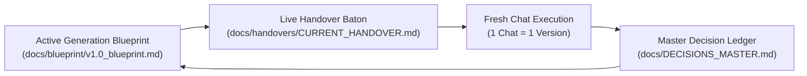

# Multi-Generation Systems Architecture Blueprint (`main_blueprint.md`)

**North Star Product Vision**: A zero-knowledge, offline-first personal diary and private task companion where every entry, mood, tag, notebook, voice note, photo, and avatar is AES-GCM 256-bit encrypted on-device before leaving the browser or Android WebView—combining effortless daily reflection with mathematically verifiable privacy.

---

## Blueprint-Driven Execution Loop

---

## Multi-Generation Roadmap

| Generation | Version Span | Theme & Core Capabilities | Status | Blueprint File |
| :--- | :--- | :--- | :---: | :--- |
| **Gen 1A (Foundation)** | `v1.0.0` ➔ `v1.0.21` | Core E2EE Diary, Personal Tasks, Android Capacitor, MWG Baseline, `<dialog>` Modals, 16-Item Security Audit Remediation, Mobile Bottom-Nav Robustness | `[x] DONE` | [`v1.0_blueprint.md`](./v1.0_blueprint.md) |
| **Gen 1B (Stabilization & GA)** | `v1.0.22` ➔ `v1.0.31` | CI Deploy Parity, Zero-Knowledge Privacy Leak Closure, Background Batch Hydration (Search/Journals/OnThisDay), Editor Lifecycle, Blob Leak Cleanup, Outbox UI, Android & Supabase GA Sign-Off | `[ ] ACTIVE` | [`v1.0_blueprint.md`](./v1.0_blueprint.md) |
| **Gen 2 (Multi-Vault & Sync)** | `v1.1.0` ➔ `v1.1.10` | Archive Import & Vault Restore, Zero-Knowledge Master Password Rotation, Multi-Vault Cryptographic Sub-Keys, CRDT Delta Sync, Asymmetric Entry Sharing | `[ ] PARKED` | *Deferred until `v1.0.31` GA* |
| **Gen 3 (Desktop & Edge AI)** | `v2.0.0` ➔ `v2.0.10` | Tauri/Rust Native Desktop Client, Encrypted Local Filesystem Backups, On-Device WebGPU/WASM Reflection & Encrypted Vector Search | `[ ] PARKED` | *Deferred until Gen 2* |
